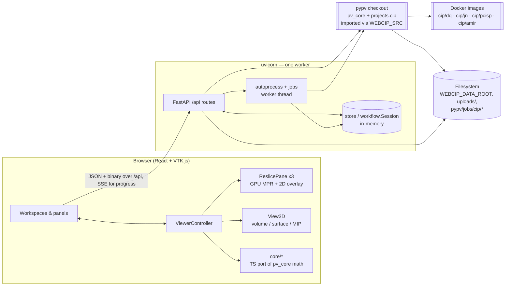

# WebCIP — Architecture

WebCIP is the web port of the **CIP** (cochlear-implant planning) desktop app. It opens CT scans,
saved plans (`.pws`/`.pwi`), postop data blocks (`.cdb`) and past pipeline runs. It shows them in
a four-up MPR + 3D viewer and runs the CIP processing pipeline (atlas registration, implant
erase, structure segmentation, electrode search), either unattended or one step at a time.

The design has one rule: **Python decodes the files once, and the browser does all the
rendering.**

- `pv_core` already reads DICOM/NIfTI/raw, plan and `.cdb` formats and drives the Docker tools.
  The backend reuses it unchanged and adds a thin layer over it.
- The backend never renders or resamples an image. It sends the browser raw voxels plus
  geometry, and meshes already transformed into the world frame.
- The browser renders everything with VTK.js on the GPU: slicing, blending, overlays, the 3D
  view and picking. The coordinate math it needs is ported to TypeScript and tested against
  the Python output.

Related docs: [README.md](README.md) (how to run) ·
[deploy/SERVER_SETUP.md](deploy/SERVER_SETUP.md) (server install) ·
[PORTING_NOTES.md](PORTING_NOTES.md) (desktop-to-web decisions) ·
[VISUALIZATION_FEATURES.md](VISUALIZATION_FEATURES.md) (feature list) ·
[progress.md](progress.md) / [HANDOFF.md](HANDOFF.md) (work log).

---

## 1. System overview



| Layer | Tech | Location |
|---|---|---|
| Frontend | Vite 8, React 19, TypeScript 6, VTK.js 32, Recharts, jsPDF | `frontend/` |
| Backend | FastAPI + uvicorn, Python 3.10+, numpy, SimpleITK, VTK (Python) | `backend/` |
| Domain library | `pv_core` and `projects.cip` from the separate **pypv** repo (`git@github.com:nvrads/pypv.git`) | not in this repo; found through `WEBCIP_SRC` |
| Tools | Four Docker images run by `pv_core.tools` | built and loaded on the host |
| Deployment | systemd unit + Apache reverse proxy at `/webcip/` | `deploy/` |

### External dependency: pypv

`backend/pvcore_path.py` adds `$WEBCIP_SRC` (default `/data/mipwork/pypv`) to `sys.path`. Every
backend module that imports `pv_core` or `projects.cip` depends on that checkout, so **the backend
will not start without it**. The frontend builds and its tests run without it.

`projects.cip` imports PySide6 when it loads, so the backend sets `QT_QPA_PLATFORM=offscreen`.
It never creates a `QApplication`. The desktop's `auto_process.py` drives Qt dialogs and cannot
be imported here, so `backend/autoprocess.py` re-implements only its orchestration. The Qt-free
code under it is reused as-is: the tool wrappers, the transforms and the output parsers.

---

## 2. Repository layout

```
backend/
  app.py              FastAPI app: middleware, /api router, serves frontend/dist at /
  pvcore_path.py      puts $WEBCIP_SRC on sys.path (pv_core, projects.cip)
  store.py            in-memory image store: pv_core Image by id, raw voxel bytes
  workflow.py         the single workflow Session: images + roles, ear, plan state, step gating
  hold.py             webcip_sid cookie; who holds the shared workspace (409 + takeover)
  autoprocess.py      headless pipeline: Run + run_atlas/erase/segment/postop/electrodes
  jobs.py             one-at-a-time background job runner, event queue for SSE
  result.py           turns a Run into the .cdb-shaped payload (shared by live runs + job folders)
  jobfolder.py        rebuilds a Run from a past job folder (pypv/jobs/cip/<ts>/)
  bake.py             maps plan objects (points + meshes) from image frame into global world
  plan_mesh.py        plan mesh -> welded vtkPolyData with normals -> binary blob; tube meshes
  mesh_io.py          parses case-folder structures.pkl/implants.pkl streams (not pickle)
  mesh_config.py      per-type mesh colour/opacity/render order (mesh_config/NN.json)
  routes/             one module per API area (see §3.2)
  requirements.txt    direct deps;  requirements.lock.txt  pinned deploy set

frontend/
  index.html, vite.config.ts      base './' (mount-agnostic), dev proxy /api -> :8011
  src/main.tsx, App.tsx           theme + HashRouter: /viewer (Processing), /display (Display)
  src/api/        client.ts (every backend call, binary parsers), paths.ts (runtime mount/API root)
  src/core/       pure TS ports of pv_core math + domain types (no DOM/vtk; unit-tested)
  src/render/     imperative VTK.js scene: ReslicePane, View3D, ViewerController, overlays, viewScope
  src/workspaces/ ProcessingApp (four-up + workflow), DisplayApp (result display)
  src/layout/     AppShell (resizable docks), ErrorBoundary
  src/panels/     React control panels (workflow column, right dock, dialogs, electrode dock)
  src/charts/     electrode analysis charts, MIP view, PDF report

deploy/           webcip.service, apache-webcip.conf, install.sh, deploy.sh, prune/restart timers,
                  subpath_test.py (rehearses the /webcip/ mount locally), SERVER_SETUP.md
uploads/          browser uploads + default data root (gitignored: patient data never enters git)
```

---

## 3. Backend

### 3.1 Runtime model

**One process, one workspace.** All state is held in memory at module level:

| State | Module | What it holds |
|---|---|---|
| `_STORE` | `store.py` | decoded `pv_core.image.Image`s by id (never evicted; a nightly restart timer clears it) |
| `_SESSION` | `workflow.py` | the single `Session`: an `autoprocess.Run` (images with roles, ear, planning objects, matrices) plus the hold |
| `_JOBS` | `jobs.py` | pipeline jobs and their event queues |
| registries | `routes/plan.py`, `cdb.py`, `case.py` | opened plans / cdbs / cases with their mesh blobs, by id |

This means:

- **uvicorn must run with exactly one worker.** A second worker would have its own separate
  state.
- Every browser shares the same workspace. `hold.py` makes that visible. The first browser to
  change something holds the workspace. Changes from any other browser get **409**, and the
  page shows an "in use" banner with a *Take over* button. An idle hold expires after 3 minutes.
  It never expires while a step is running. Scripts should call `POST /api/workflow/release`
  when they finish.
- A restart loses all loaded state. Results can be reopened from disk (`/api/job`, `/api/cdb`).

The manual steps and Auto process share one `autoprocess.Run` on the session. That way step 4
can see what step 3 produced, as on the desktop. `workflow.py` also ports each step's
`is_available()`. The browser asks for the state and greys out the steps that aren't ready, so
the gating rules exist only on the server.

### 3.2 API (all under `/api`)

| Area | Routes | Module |
|---|---|---|
| Server info | `GET /health`, `GET /config`, `GET /openable` (scans `WEBCIP_DATA_ROOT` + the jobs root for openable cases, plans, cdbs and runs) | `app.py`, `routes/config.py` |
| Files | `GET /browse?path=&kind=` (server-side file picker), `POST /upload-file` | `routes/browse.py` |
| Images | `POST /load {path,name,role}`, `POST /upload` (multipart), `GET /images`, `PUT /images/{id}/role`, `DELETE /images/{id}` | `routes/load.py` |
| Pixels & meta | `GET /volume/{id}` (raw buffer, `X-Dtype`/`X-Dims` headers), `GET /header/{id}`, `GET /surface/{id}?iso=&cutoff=` (isosurface blob), `GET /colormaps`, `GET /colormap/{i}` | `volume.py`, `header.py`, `surface.py`, `colormaps.py` |
| Saved plan | `POST /plan {path}`, `GET /plan/{id}/mesh/{key}` | `routes/plan.py` |
| Postop data block | `POST /cdb {path,side}`, `GET /cdb/{id}/mesh/{key}`, `/graph`, `/mip`, `/mip/points` | `routes/cdb.py` |
| Result case folder | `POST /case {folder}`, `GET /case/{id}/curves`, `/meshes/{group}`, `/mesh/{group}/{i}` | `routes/case.py` |
| Past run | `POST /job {folder}` (rebuilds from tool outputs, returns the cdb payload) | `routes/job.py` |
| Workflow | `GET /workflow`, `POST /workflow/side`, `/claim`, `/release`, `/clear`, `/clear-structures`, `/clear-electrodes` | `routes/auto.py` |
| Pipeline | `POST /step/{key}` (one manual step), `POST /auto/start`, `GET /auto/{job}`, `GET /auto/{job}/events` (SSE), `GET /auto/{job}/result`, `GET /auto/electrodes` | `routes/auto.py` |

### 3.3 One display payload

Several sources produce displayable results: a `.cdb` file, a live pipeline run, a reopened job
folder. They are all converted to **the same `.cdb`-shaped payload**
(`result.cdb_payload`) and stored in the cdb registry. The browser therefore has a single
display path for structures, the electrode lead and the electrode dock. The mesh, graph and MIP
routes serve every source the same way. Saved plans use `routes/plan.py`, which shares the
baking step (`bake.py`).

### 3.4 Pipeline

`autoprocess.plan_steps(images)` picks the route:

```
preop only (implanted scan):  atlas (cip/dq) -> erase (cip/jn) -> segment (cip/pcisp) -> electrodes (cip/pcisp)
preop + postop:               atlas (cip/dq) -> segment (cip/pcisp) -> postop (DL + cip/amir) -> electrodes
```

Each `run_*` function changes the shared `Run` (images, objects, `state`) the same way the
desktop step does. Instead of opening Qt pop-ups, the functions raise `StepFailed`. `jobs.py`
runs one job at a time on a worker thread. Its events (status, elapsed time, the tool's last log
line, a progress fraction) mirror the desktop's progress sink. The browser follows them over
SSE and can reconnect after a page reload. Every tool run writes its inputs and outputs to
`pypv/jobs/cip/<timestamp>/`. `jobfolder.py` can rebuild the scene from that folder later.
Disk space is reclaimed by an age-based systemd timer (7 days), never at startup.

### 3.5 Wire formats

- **Volume:** raw little-endian voxels, x fastest. Dtype and dims are in response headers.
  Geometry (direction, spacing, world matrix, default window/level, crop origin) arrives in the
  JSON from `/load`.
- **Mesh blob** (shared by surface, plan, cdb and case meshes):
  `[points f32 × 3V][normals f32 × 3V][triangles u32 × 3F]`, already in global world. The
  parser is `api/client.ts::parseMeshBlob`.
- **Compression:** `GZipMiddleware` compresses JSON. `/volume` and `/surface` set
  `Content-Encoding: identity` so they are sent uncompressed. CT voxels barely compress, and
  gzip made those responses 20× slower.

---

## 4. Frontend

### 4.1 Layers

```
workspaces/  ProcessingApp, DisplayApp     React: layout, data loading, wiring panels to the controller
panels/, charts/                           React: controls and read-outs; call controller setters, subscribe()
render/viewerController.ts                 the single mutable scene + view state; emits on change
render/ReslicePane.ts, View3D.ts           imperative VTK.js renderers (one per pane)
render/reslice.ts, volumeData.ts, overlay/ VTK data construction + 2D overlay methods
core/                                      pure math + domain types (no DOM, no vtk), unit-tested
api/                                       fetch layer + binary parsing
```

React does **not** own the rendered scene. `ViewerController` is a plain object that holds the
scene state: images, the top/bottom slots, crosshair, zoom, orientation, modes, structures and
camera. It pushes changes straight to the VTK panes. Panels call its setters and re-render
through `subscribe()` (`panels/ui.tsx`). This keeps the 60 fps paths (slicing, crosshair drags)
outside React's render cycle.

### 4.2 Workspaces (HashRouter)

- **`/viewer` — ProcessingApp.** The desktop main window. `AppShell` lays out resizable docks:
  - Left: the workflow column (numbered steps, Structures checklist, Electrodes table, pinned
    *Save file* footer).
  - Centre: the four-up grid (`FourUp.tsx`: coronal, sagittal, axial, 3D).
  - Right: Coordinates, Information, Orientation, Display, Planning.
  - Bottom: the electrode dock (Curves, MIP, charts, PDF).
  - Also: the 2D tool toolbar (registration, crop, measure, overlay) and the Auto-process and
    Validation dialogs.
- **`/display` — DisplayApp.** The result-display layout: a large 3D view on top, three small
  MPR panes below and a left sidebar. Same scene modules, different layout.

Both use `render/useScenePanes.ts` to create the three `ReslicePane`s and the `View3D` on their
host elements and attach them to a controller.

### 4.3 Rendering

- **`ReslicePane`** (2D MPR). Each image slot is a 3D texture sliced by a world-space plane
  through the crosshair (`vtkImageResliceMapper`, hardware trilinear). Two slots are blended by
  drawing the opaque bottom slot, then the top slot at `blendAlpha`. Each actor's `userMatrix`
  is `inv(image.worldMatrix)`, so manual registration moves the slot live. A 2D canvas HUD on
  top draws the crosshair, labels, tool feedback and **structure cross-sections**.
- **2D structure overlay** (`render/overlay/`). This is a pluggable `OverlayMethod`
  (mesh-projection fill or contour stroke). `vtkCutter` cuts each mesh with the slice plane, and
  `structureCaps.contourLoops` chains the segments into polylines. Closed loops are filled
  even-odd; open arcs are stroked. Cuts are cached in world space, so they are recomputed only
  when the slice moves.
- **`View3D`** has a per-image render mode (volume, server-built surface, MIP or none), structure
  and implant actors, trajectories and guidance accessories (`trajectory3d.ts`), the world-axis
  crosshair, an orientation marker and GPU picking. It uses parallel projection by default, like
  the desktop.
- **`viewScope.ts`** is the reusable seam for *takeover* panels such as Validation. It
  snapshots the whole view state, lets the panel use the normal controller setters and restores
  everything on exit. It also keeps the workspace hold alive with a heartbeat while the panel is
  open.

### 4.4 Coordinate frames

Everything on screen is in **global world**:

```
image pixel (i,j,k) -> image world (L/P/S mm, centred on the volume) -> global world (Image.world_matrix)
```

- `core/geometry.ts`, `core/image.ts`, `core/mat4.ts`, `core/scene.ts` and `core/coords.ts` port
  the matching `pv_core` modules literally, including row-major numpy matrix semantics.
  `core/__tests__/reference.json` holds values computed in Python, and the tests check the TS
  ports against them.
- The backend bakes plan objects and meshes into global world before sending them (`bake.py`),
  so the client never does image-frame math for them.
- Cropped `.cdb` images have a `cropOrigin` (`render/volumeData.ts`).

### 4.5 Mount-agnostic build

`vite.config.ts` sets `base: './'`. `api/paths.ts` derives `MOUNT` and `API` from
`document.baseURI` at runtime. One `dist/` therefore works at `/` (local) and at `/webcip/`
(behind Apache). Apache must redirect `/webcip` to `/webcip/`. Hash routing keeps the page path
fixed at the mount point.

---

## 5. Main data flows

**Open a scan.** The user picks a file, either a server path (`FilePicker` → `/api/browse`) or
an upload. The browser calls `POST /api/load` (or `/upload`). `pv_core` decodes the file into an
`Image` and puts it in `store`. The response is geometry JSON. The browser then fetches
`GET /api/volume/{id}` as an ArrayBuffer and builds a `vtkImageData` (`volumeData.ts`). The
controller assigns it a slot, and the panes render it.

**Open a plan or `.cdb`.** `POST /api/plan` or `/api/cdb` uses `pv_core.workspace.load_workspace`
or `projects.cip.cdb_scene.assemble`. The routes register the images, bake the objects into
world space and strip vertex arrays out of the JSON. The browser loads volumes and meshes
(`/mesh/{key}`) and fills the Structures and Electrodes lists. A `.cdb` opens read-only.

**Run the pipeline.** `POST /api/auto/start` (or `/step/{key}`) creates a job and returns
immediately. The browser subscribes to `/auto/{job}/events` (SSE). After each step it fetches
`/auto/{job}/result`, which returns the cdb payload, and updates the scene, so results appear as
they arrive. After a clean auto run the Validation panel opens.

---

## 6. Deployment

```
Internet -> Apache :80  /webcip/*  --proxy-->  uvicorn 127.0.0.1:8011  (API + built SPA, 1 worker)
                                               runs as the service account, member of `docker`
```

- `deploy/install.sh` (once) installs the systemd unit, the Apache config and the timers.
  `deploy/deploy.sh` (every release) pulls this repo and pypv, installs the pinned Python deps,
  runs `npm ci && npm run build`, restarts the service and checks `/api/health`. It refuses to
  restart while a `pv-*` tool container is running, unless `--force` is passed.
- Configuration is through environment variables in `webcip.service`: `WEBCIP_SRC`,
  `WEBCIP_DATA_ROOT` (`:`-separated), `WEBCIP_UPLOAD_DIR`, `QT_QPA_PLATFORM=offscreen`.
- Host requirements (measured): **≥ 8 GB RAM** (`cip/dq` peaks around 5.3 GB), Python 3.10+,
  Node for the build, and Docker with the four `cip/*` images.

---

## 7. Testing

| What | Command | Covers |
|---|---|---|
| Frontend unit tests | `cd frontend && npm test` | core math vs Python reference values, plan objects, view fitting, reslice geometry, contour chaining, viewScope snapshot/restore, mount paths (143 tests) |
| Type check + build | `cd frontend && npm run build` | `tsc -b` + Vite production bundle |
| Lint | `cd frontend && npm run lint` | ESLint with react-hooks v7 rules (pre-existing findings remain, mostly `react-hooks/refs` on controller reads during render) |
| Backend smoke | `uvicorn backend.app:app --port 8011` then `curl :8011/api/health` | import graph incl. pypv, SPA serving |
| Subpath rehearsal | `python deploy/subpath_test.py` | the app served at `/webcip/` without Apache |

There is no automated backend test suite. Backend changes are checked by running a real step,
not only by importing the module.

---

## 8. Known limitations

- **No authentication.** CORS is `*`. `/api/browse` and the path-taking routes accept any
  readable path. Put an IP allowlist or basic auth in front until this is addressed.
- **There is only one workspace** for the whole server; sessions are not isolated per user.
  `_STORE` never evicts.
- **No plan writing.** *Save file* and the validated stamp are not ported. Reopening a past
  run uses `/api/job` instead.
- **Two-scan route, step 6:** `cip/pcisp` segfaults when the preop and postop are on different
  grids (see HANDOFF.md §6).
- **Frontend bundle:** one ~2.3 MB chunk. VTK.js dominates; there is no code splitting yet.
